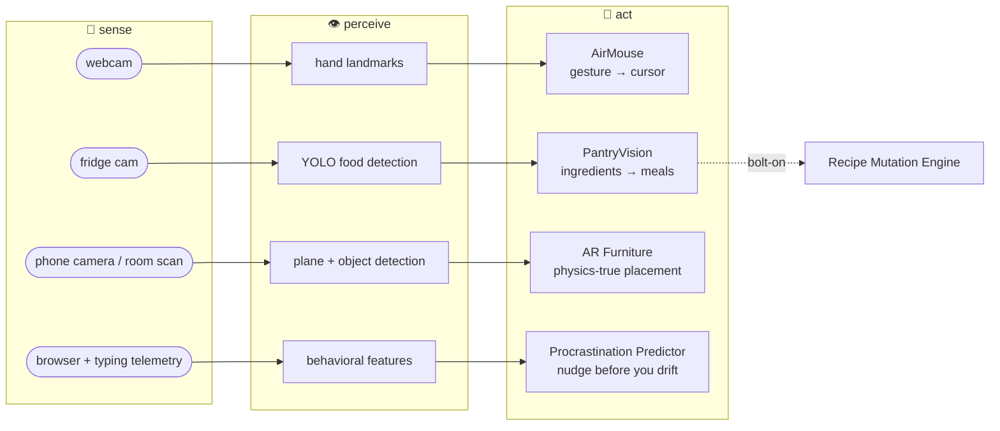

<!-- ═══════════════════════════════════════════════════════════════
     amriz26 :: autonomous_node v2026.11
     sense → perceive → plan → act
     ═══════════════════════════════════════════════════════════════ -->


<p align="center">
  <a href="https://github.com/amriz26">
    
  </a>
</p>

<p align="center">
  
  
  
  
</p>

---

```python
class Ahmed(Agent):
    location = "San Francisco, CA"
    role     = "Engineering @ Casper Studios"
    school   = "B.S. Computer Science @ SFSU"
    prev     = ["Keplr AI", "Scale AI"]
    focus    = ["AI agents", "autonomous systems", "computer vision"]

    def observe(self):
        return [webcam, fridge_cam, room_scan, typing_cadence]

    def act(self, signal):
        return {
            "hand gesture":  "move the cursor",          # AirMouse
            "fridge photo":  "suggest dinner",           # PantryVision
            "room scan":     "place furniture in AR",    # AR Furniture
            "tab switching": "warn before you drift",    # Procrastination Predictor
        }[signal]

    def loop(self):
        while caffeine > 0:
            self.act(self.observe())
```

> I build things that **look at the world and then do something about it**.
> If it has a camera, a sensor, or a messy behavioral signal, I want to turn it into an action.

---

### 🛰️ System graph



### 🧪 Active experiments

| node | input → output | stack |
|---|---|---|
| [**AirMouse**](https://github.com/amriz26/AirMouse) | webcam → hand gestures → OS cursor control | `Python` `OpenCV` `MediaPipe` |
| [**PantryVision**](https://github.com/amriz26/PantryVision) | fridge photo → detected ingredients → meal ideas | `TypeScript` `YOLO` |
| [**AR Furniture Placement**](https://github.com/amriz26/AR-Furniture-Placement-Phys-Sim) | room scan → virtual furniture with real physics constraints | `Dart` `Flutter` `CV` |
| [**Procrastination Pattern Predictor**](https://github.com/amriz26/Procrastination-Pattern-Predictor-) | app-switching + typing speed → "you're about to procrastinate" | `Python` `ML` |
| [**Recipe Mutation Engine**](https://github.com/amriz26/-Recipe-Mutation-Engine) | learns *why* recipes work → valid new variations | `Python` |
| [**Cartoon CNN**](https://github.com/amriz26/CNN-Based-Image-Classification-of-Cartoon-Characters) | pixels → which cartoon character is this | `PyTorch` `CNN` |

---

### 🔧 Actuators &amp; firmware

<p align="center">
  
</p>

### 📈 Telemetry

<p align="center">
  
  
</p>

<p align="center">
  
</p>

<p align="center">
  
</p>

---

```diff
+ currently tuning: gesture smoothing so the cursor stops vibrating like it had 4 espressos
+ currently reading: anything about agents that act in the physical world
- known bug: will start a new CV project before finishing the last one
```

<p align="center">
  <sub>📫 ping this node on LinkedIn (link in profile) · ask me about weird sensor inputs</sub>
</p>


